# TP4 - Sockets en mode non-connecté UDP (Chat)

**Étudiant :** Chayma Bouassida  
**Matière :** Développement d'applications réparties  
**Année universitaire :** 2026 – 2027

Ce projet implémente un système de chat client-serveur basé sur le protocole **UDP** (mode non-connecté) en Java. Le développement est structuré en trois étapes progressives : de l'envoi simple, vers une communication bidirectionnelle, puis vers un système de diffusion (Broadcast) multi-clients.

---

# Étape 1 : Chat Unidirectionnel

## Objectif
Développer un serveur qui écoute sur le port 1234 et un client qui envoie des messages préfixés par son nom d'utilisateur. Le serveur affiche le message avec l'adresse IP et le port.

## Code Source
### Server_4_1.java
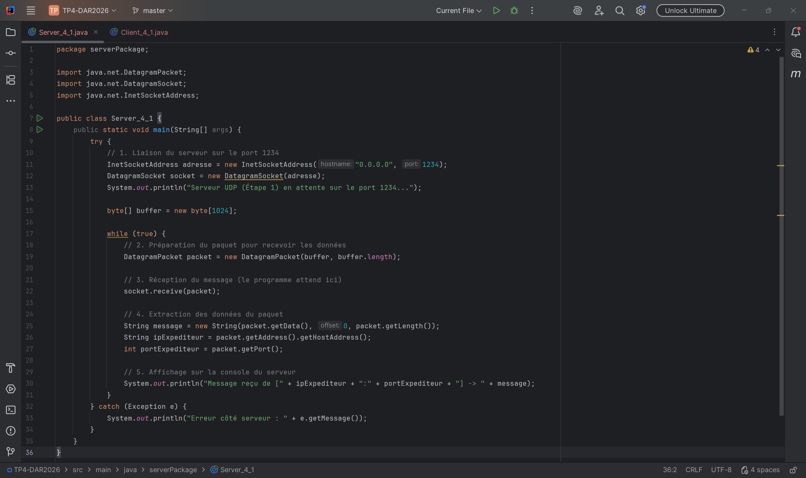

### Client_4_1.java
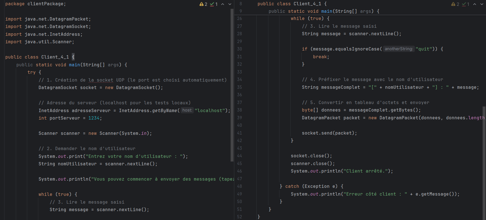

## Exécution et Tests
Démarrage du serveur en attente sur le port 1234.
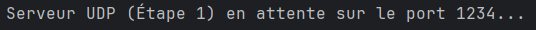

Le client `chayma` envoie un message.
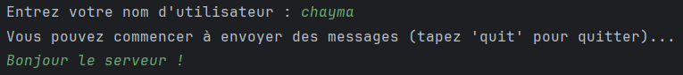

Le serveur reçoit le message avec l'IP et le port.
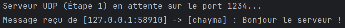

Le client tape `quit` et s'arrête.
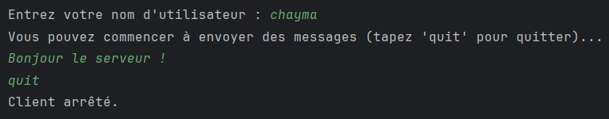

---

# Étape 2 : Chat Bidirectionnel 1-à-1

## Objectif
Le serveur ne fait plus qu'écouter, il **répond** au client. Pour que le client puisse recevoir la réponse du serveur en temps réel sans être bloqué, nous introduisons un **Thread de réception**.

## Code Source
### Server_4_2.java
Le serveur reçoit le message et renvoie une réponse à l'expéditeur.
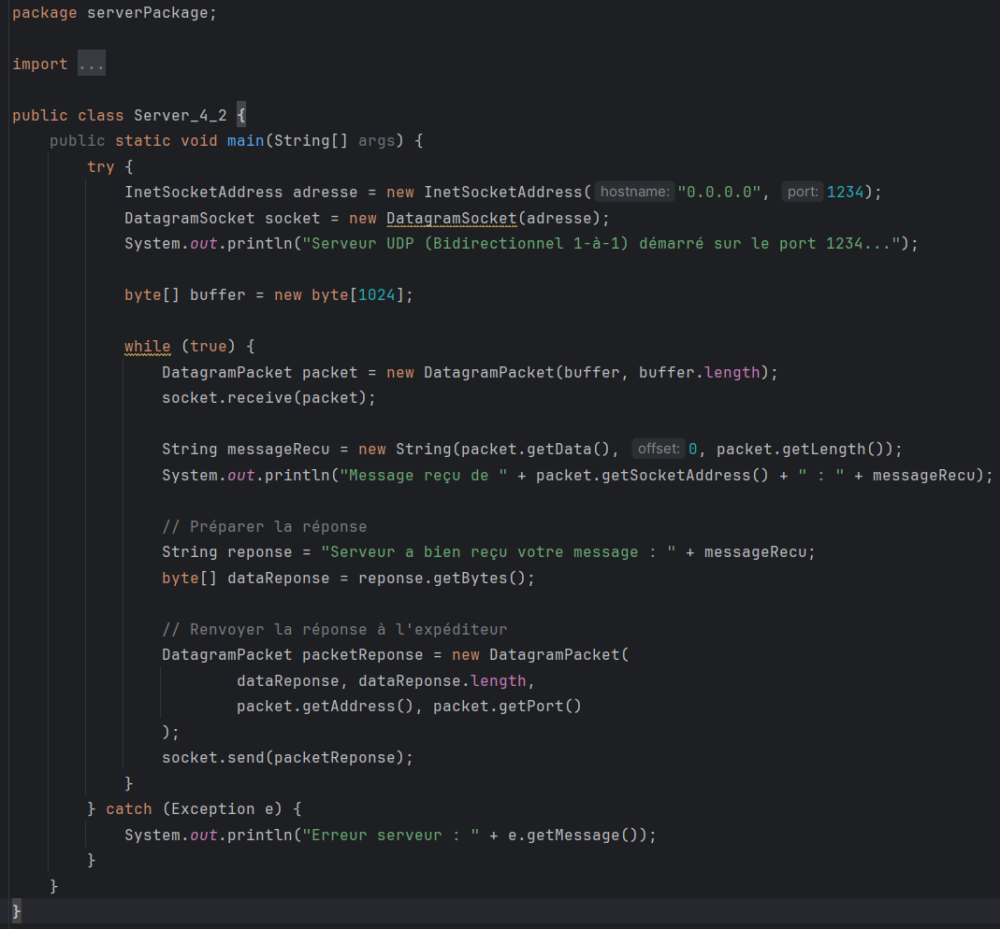

### Client_4_2.java (avec Thread)
Le client utilise une classe anonyme `Runnable` pour écouter le serveur en arrière-plan.
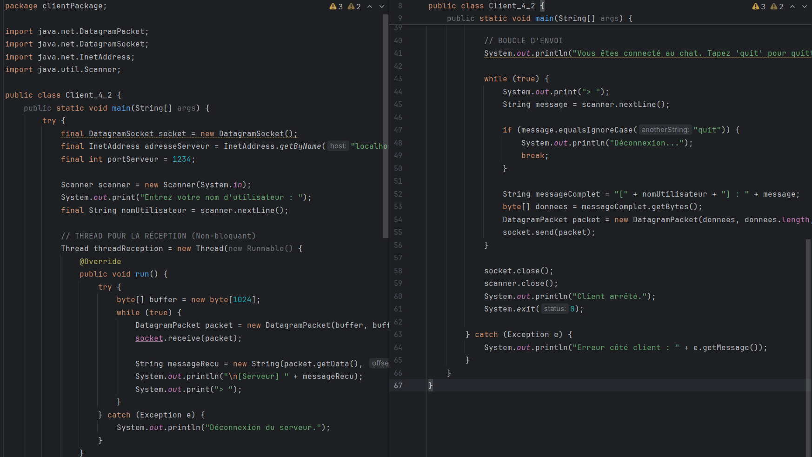

## Exécution et Tests
Démarrage du serveur 4.2.
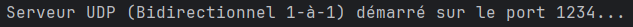

Le serveur reçoit le message et renvoie une confirmation.
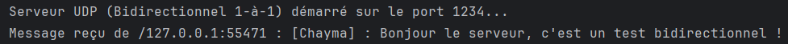

Le client reçoit la réponse du serveur tout en gardant l'invite `>` active (grâce au Thread).
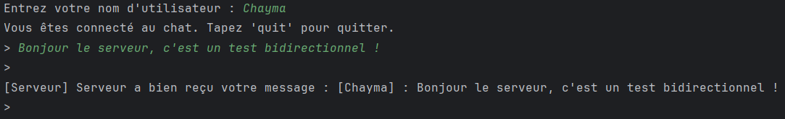

---

# Étape 3 : Chat Multi-clients et Diffusion

## Objectif
Permettre à plusieurs clients de discuter ensemble. Le serveur maintient une liste des adresses des clients et **diffuse (broadcast)** chaque message reçu à tous les autres clients.

## Code Source
### Server_4_3.java
Le serveur garde une liste de `SocketAddress` et fait le routeur.
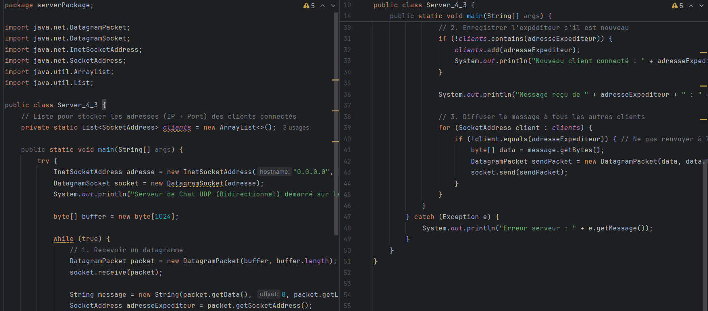

### Client_4_3.java (avec Thread et message de connexion)
Le client utilise un Thread et envoie un message "Join" automatique dès son lancement.
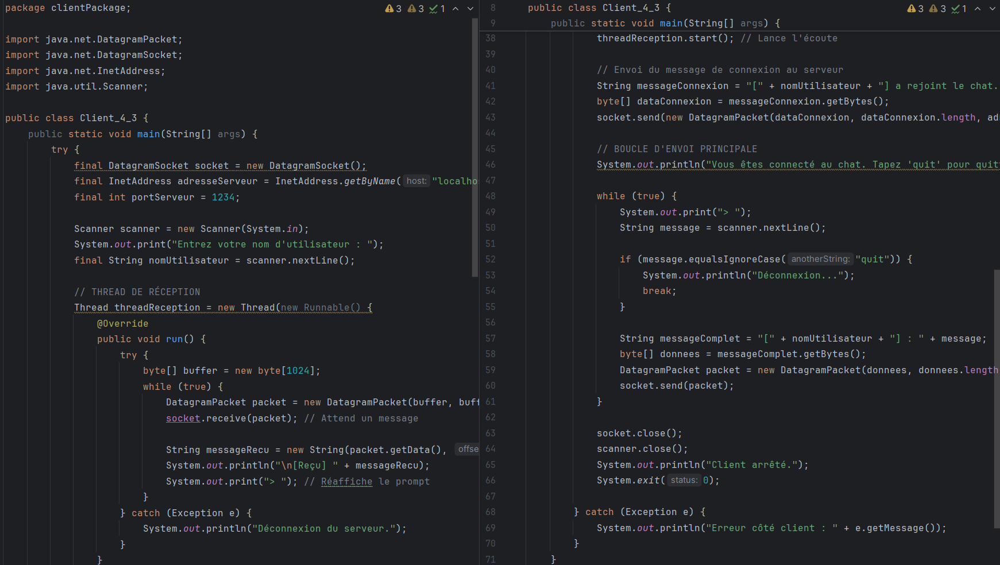

## Configuration pour les tests locaux
Activation de l'option **"Allow multiple instances"** dans IntelliJ pour lancer plusieurs clients sur la même machine.
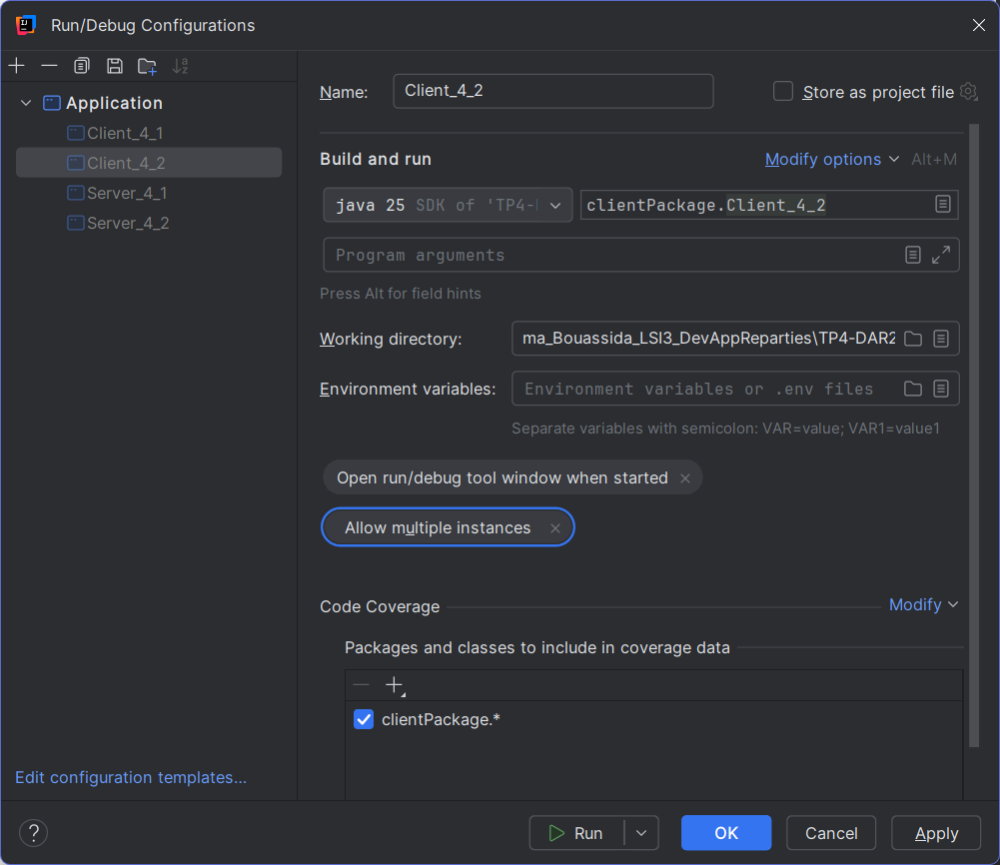

## Exécution et Tests

### 1. Démarrage du serveur
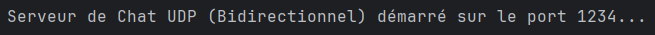

### 2. Connexions des clients (Message "Join")
**Alice** rejoint le chat.

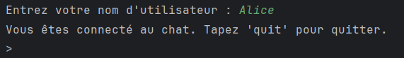

Le serveur enregistre Alice.

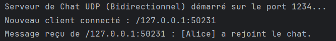

**Bob** rejoint le chat.

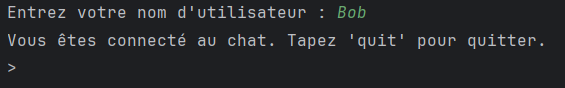

Le serveur enregistre Bob.

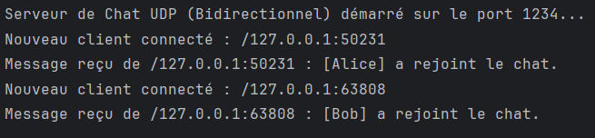

**Charlie** rejoint le chat.

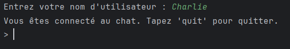

Le serveur enregistre Charlie.

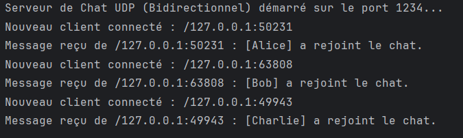

### 3. Diffusion des notifications
Alice est notifiée quand Bob rejoint.

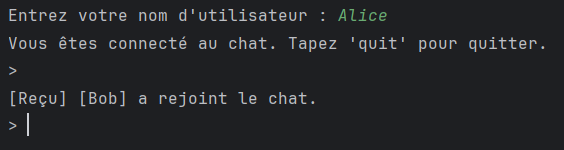

Alice est notifiée quand Charlie rejoint.

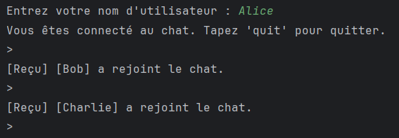

Bob est notifié quand Charlie rejoint.

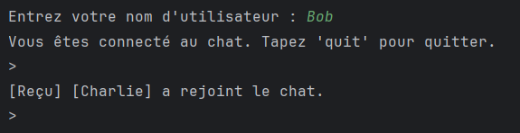

### 4. Diffusion d'un message de chat
Alice envoie "Salut tout le monde !".

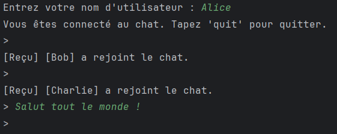

Bob reçoit le message en temps réel.

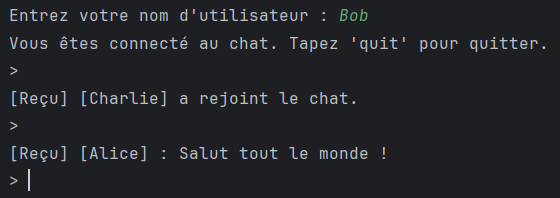

Charlie reçoit le message en temps réel.

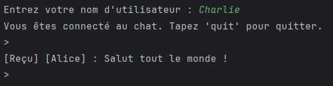

### 5. Logs complets du Serveur (Preuve finale)
La console du serveur montre l'enregistrement des 3 clients et la diffusion du message.

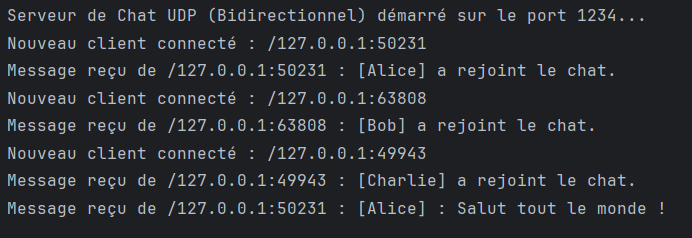

## Synthèse
1. **UDP vs TCP :** UDP étant non-connecté, le serveur ne détecte pas l'arrivée d'un client. Le client envoie donc un message "Join" automatique au démarrage pour s'enregistrer.
2. **Diffusion :** Le serveur utilise une boucle `for` pour rediriger les messages vers tous les autres clients connectés (excepté l'expéditeur).
3. **Threads :** Le client utilise un Thread (`Runnable`) pour écouter en arrière-plan, rendant la réception non-bloquante pendant la saisie.
